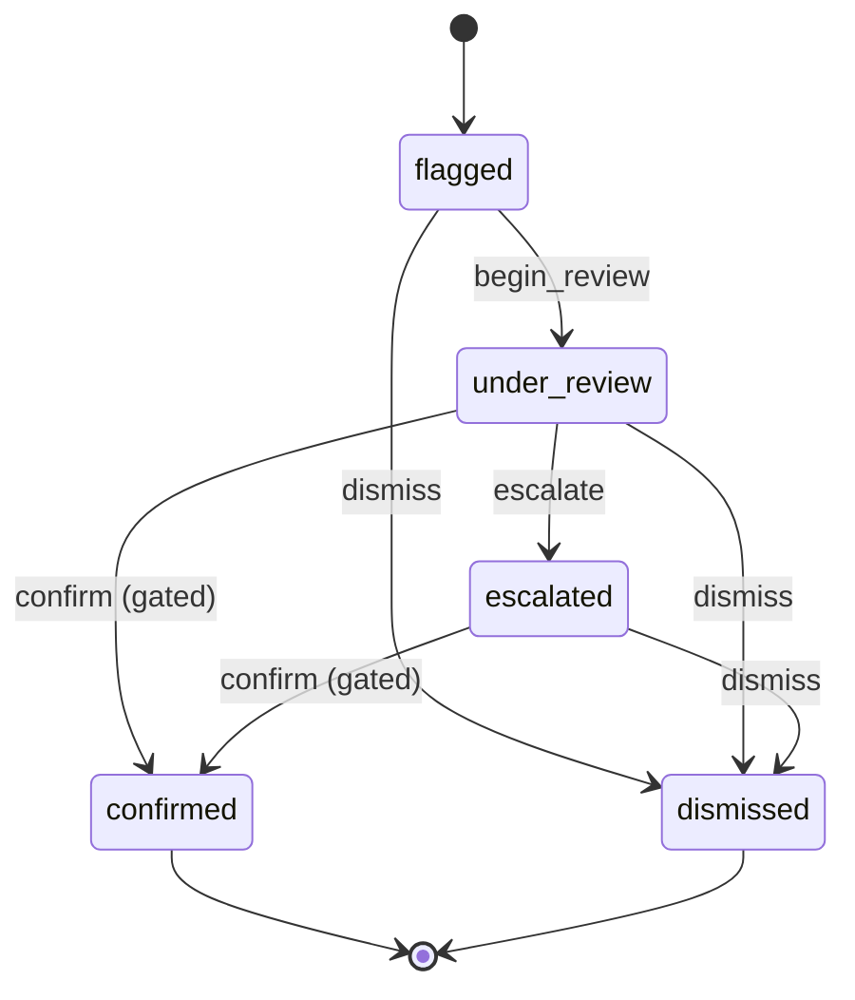
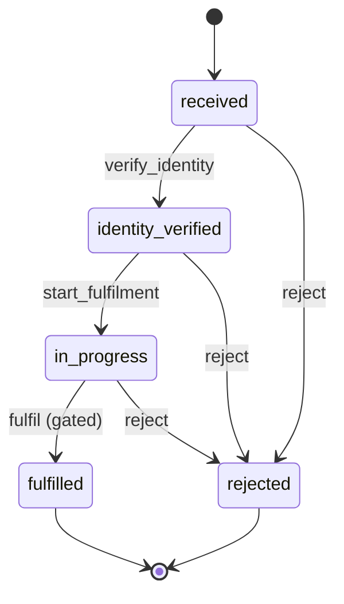

# Governance

The `governance` bounded context (`packages/governance`) holds organization administration, policy management, compliance workflows and data retention. This guide covers the sections that exist so far; sections for the other parts are added by their own changes.

## Compliance workflows

Compliance operations are multi-step and multi-actor: reviewing a flagged verification, answering a data subject request. Each is a `ComplianceCase` moving through a workflow's **transition table**.

### The transition table is data

`packages/governance/domain/workflow-definitions.ts` holds one definition per workflow type: a map of `state -> event -> { to, gated? }`. `ComplianceCase.transition` looks the pair up and either moves or refuses. There is no per-workflow `if` or `switch` anywhere else.

**Why a table:** it can be reviewed at a glance, and it is where an auditor should verify the rules. **Rejected alternative:** one subclass per workflow overriding a `canTransition` method. That scatters the rules across files, and "what can happen from state X" becomes a question you answer by tracing code.

A missing entry means the event is illegal. There is no wildcard and no fallback, so a typo or a new state cannot accidentally be allowed.

Callers send an **event** (`confirm`), never a target state. The API cannot be told "set the state to `confirmed`": the table decides where an event leads.

#### `verification-review`

Approval slots for `confirm`: `compliance-officer`, `legal-counsel`.

#### `data-subject-request`

Approval slots for `fulfil`: `compliance-officer`, `data-protection-officer`.

Terminal states accept no further events and no approvals.

### State history

Every case carries an append-only history. The first entry is `opened` (`fromState: null`); each accepted transition appends `fromState`, `toState`, `event`, `actorId` and `occurredAt`. Nothing edits or removes an entry, and a refused transition leaves the history untouched. The approval decisions live beside it in the approval chain with their own approver and timestamp, and each also raises a domain event.

### Approval chains

A gated transition (marked `(gated)` above) is refused until the case's `ApprovalChain` is satisfied.

- Each required role is one **slot**, filled by an `approved` decision for that role.
- A person can record **one decision per case**. Someone who holds two roles cannot fill two slots, so two-person review cannot be satisfied by one person.
- A `rejected` decision blocks the gated transition for good, and later approvals are refused. The case can still be closed another way (`dismiss`, `reject`), so a rejection never strands it.
- Partial approval is tracked: the case reports `pendingRoles`, and a refused transition names the roles still missing.

**Judgement call:** a rejection does not move the case by itself. We rejected automatic transition on rejection because the right outcome (dismiss, escalate, ask for more evidence) is a decision for the operator, and the table should stay the only thing that moves a case.

### Domain events

| Event                                          | Raised when                            |
| ---------------------------------------------- | -------------------------------------- |
| `governance.compliance_case.opened`            | A case is opened                       |
| `governance.compliance_case.transitioned`      | A transition is accepted               |
| `governance.compliance_case.approval_recorded` | An approval or a rejection is recorded |

Use cases publish events only after the repository accepted the save, so an event never describes something that was not persisted.

### HTTP API

Routes live in `packages/governance/interface/http/compliance-case-routes.ts` and are mounted under `/admin`. The contract is in `apps/api/openapi/openapi.yaml`.

| Method | Path                                                               | Permission                                                        |
| ------ | ------------------------------------------------------------------ | ----------------------------------------------------------------- |
| POST   | `/admin/organizations/:orgId/compliance-cases`                     | `compliance-cases:write`                                          |
| GET    | `/admin/organizations/:orgId/compliance-cases`                     | `compliance-cases:read`                                           |
| GET    | `/admin/organizations/:orgId/compliance-cases/:caseId`             | `compliance-cases:read`                                           |
| POST   | `/admin/organizations/:orgId/compliance-cases/:caseId/transitions` | `compliance-cases:write`                                          |
| POST   | `/admin/organizations/:orgId/compliance-cases/:caseId/approvals`   | `compliance-cases:approve` plus `compliance-cases:approve:<role>` |

The list endpoint filters by `state`, `type` (workflow type) and `assignee`; all supplied filters must match.

Guarantees worth knowing:

- **The server enforces the state machine.** The only way a case changes state is the transition table, evaluated server-side; request bodies carry an event, and unknown body keys (such as a `state`) are stripped before the handler runs.
- **Permissions are checked against the organization in the path**, not one the caller claims.
- **Cases are scoped to their organization.** A case id from another organization answers `404`, the same as a missing id, so ids cannot be probed across tenants.
- **Denials are generic.** A `403` never names the permission or role that was missing, so it cannot be used to enumerate roles.
- **Concurrent writers cannot lose a decision.** Each change bumps a version, and the repository refuses a save from a stale copy with `409`.

Request shape is validated with JSON Schema (`schemas/compliance-case-schemas.ts`); which transitions are legal is the domain's decision and is not duplicated there.

**Judgement call:** approver eligibility is a separate port (`ApproverEligibility`) rather than a role string the client sends. A client-asserted role would let anyone sign off as anyone. The API composition answers it from RBAC: signing off as role `R` needs `compliance-cases:approve:R` in the organization.

### Known limitations

- Cases are stored by `InMemoryComplianceCaseRepository`: they are lost on restart and not shared between API instances. A database-backed adapter implements the same `ComplianceCaseRepository` port and is the intended follow-up; the port documents the organization scoping and version check it must keep.
- The caller is identified by the `x-user-id` header, the same interim arrangement as the RBAC admin routes, until the principal plugin lands. These routes must only be reachable behind the session layer.

## Retention enforcement

A `RetentionRule` declares how long one category of data may be kept and what happens afterwards. `RetentionEnforcementJob` (`packages/governance/application/retention-enforcement-job.ts`) turns those declarations into action. It is meant to be run on a schedule by calling `run(now)`; it holds no timer of its own.

### Governance does not reach into other contexts

The job never touches another context's tables. Each context implements `RetentionTarget` (`application/ports/retention-target.ts`) for its own data:

| Resource type  | Implemented by                                           | Actions               |
| -------------- | -------------------------------------------------------- | --------------------- |
| `sessions`     | `SessionRetentionTarget` in `packages/sessions`          | `delete`, `anonymize` |
| `verification` | `VerificationRetentionTarget` in `packages/verification` | `delete`, `archive`   |
| `audit_export` | none yet                                                 | `archive` only        |

The port is a contract written in prose (scoping, honest cutoff, no repeats, bounded batches, idempotent `apply`, honest about unsupported actions). A second implementation is interchangeable only if it keeps all of it. The contexts implement the port **structurally**, with no import of governance, so neither side depends on the other; `apps/api/src/composition/retention-targets.spec.ts` assigns them to the port and stops compiling if they drift.

Each target sits on a narrow store port of its own (`SessionRetentionStore`, `VerificationRetentionStore`) so it does not depend on how that context persists data.

### Idempotent by design

The job can be re-run at any time, including after a crash halfway through a batch. This is the same "at-least-once needs idempotent handlers" reasoning as any queue consumer: assume every step can happen twice and make the second time harmless.

1. `apply` is idempotent. Deleting something already deleted, or anonymizing something already anonymized, returns `already_applied` and changes nothing. This covers the unavoidable window between "the record changed" and "the job wrote it down".
2. The job checks its action log first and skips work already completed.
3. `findExpired` never re-offers a record already handled with the same action, so anonymize and archive (which leave the row in place) do not rediscover it every run.

**Rejected alternative:** a run lock plus a "progress marker". It makes crash recovery depend on cleaning up the lock and marker. Idempotent actions need no cleanup.

A failed action is logged as `failed` and the job carries on with the rest; the next run retries it. If a whole batch makes no progress the rule's run stops, so a persistent failure cannot spin.

### Every action is recorded

`RetentionActionLog` is an append-only record with the rule id, resource id, action and outcome (`applied`, `already_applied`, `refused`, `failed`) of everything the job did, plus a reason for refusals and failures.

### Audit records are never deleted

`PERMITTED_RETENTION_ACTIONS` is a table of which actions each resource type may ever be given, and `audit_export` permits `archive` only. It is checked twice: when a rule is created, and again by the job before any target is touched, because a rule rebuilt from storage never passes through creation. See `docs/security/threat-model-governance.md` for why.

### Known limitations

- The stores behind the two targets are in-memory. Database-backed stores are follow-up work behind the same ports; they must keep the contracts documented on the store interfaces (organization scoping, never returning live records, excluding already-handled records).
- Session retention scopes by organization through an `OrganizationUserLookup`, because sessions are keyed by user. The composition root must supply it from the identity context.
- The job is not yet scheduled or composed in the API, and there is no audit-export target yet.
- `RetentionRule` here is the minimum the job needs. Versioning and overlapping-rule rejection belong to the retention-rule model issue (#369).
