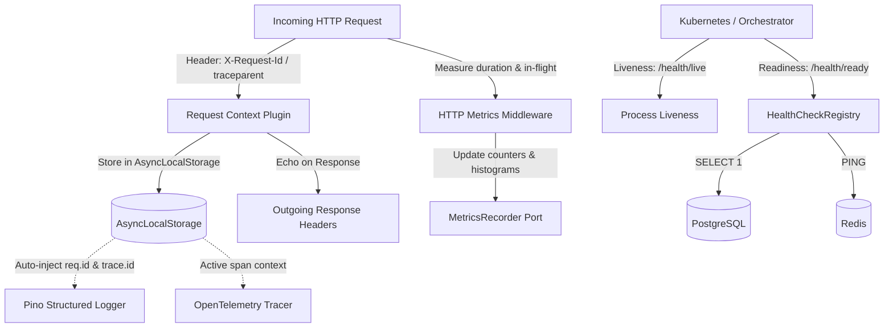

# Tutorial: Adding Observability to a Service

This tutorial walks through wiring the four pillars of production observability—correlation IDs, structured logging, Prometheus metrics, distributed tracing, and health checks—into a clean architecture service, using Verixa's `packages/observability` and `apps/api` as the reference implementation.

Every concept and architectural claim in this tutorial is backed by real code and automated tests from Phase 18 (Issues 341–360):

- **Request Context Foundation (Issue 341)**: [`packages/observability/infrastructure/request-context.ts`](file:///C:/Users/USER/documents/Tyreenn/verixa/packages/observability/infrastructure/request-context.ts) & [`packages/observability/infrastructure/request-context.spec.ts`](file:///C:/Users/USER/documents/Tyreenn/verixa/packages/observability/infrastructure/request-context.spec.ts)
- **Contextual Pino Logger (Issue 344)**: [`packages/observability/infrastructure/logger.ts`](file:///C:/Users/USER/documents/Tyreenn/verixa/packages/observability/infrastructure/logger.ts) & [`packages/observability/infrastructure/logger.spec.ts`](file:///C:/Users/USER/documents/Tyreenn/verixa/packages/observability/infrastructure/logger.spec.ts)
- **Metrics Port & Cardinality Guards (Issue 347, 348)**: [`packages/observability/application/ports/metrics.ts`](file:///C:/Users/USER/documents/Tyreenn/verixa/packages/observability/application/ports/metrics.ts) & [`packages/observability/infrastructure/prometheus-metrics-recorder.ts`](file:///C:/Users/USER/documents/Tyreenn/verixa/packages/observability/infrastructure/prometheus-metrics-recorder.ts)
- **HTTP Metrics Middleware (Issue 349)**: [`apps/api/src/plugins/http-metrics.ts`](file:///C:/Users/USER/documents/Tyreenn/verixa/apps/api/src/plugins/http-metrics.ts) & [`apps/api/src/plugins/http-metrics.spec.ts`](file:///C:/Users/USER/documents/Tyreenn/verixa/apps/api/src/plugins/http-metrics.spec.ts)
- **OpenTelemetry Tracing Bootstrap (Issue 352)**: [`packages/observability/infrastructure/otel-bootstrap.ts`](file:///C:/Users/USER/documents/Tyreenn/verixa/packages/observability/infrastructure/otel-bootstrap.ts) & [`apps/api/src/instrumentation.ts`](file:///C:/Users/USER/documents/Tyreenn/verixa/apps/api/src/instrumentation.ts)
- **Correlation ID ↔ Trace ID Linkage (Issue 355 / #467)**: [`apps/api/src/plugins/request-context.ts`](file:///C:/Users/USER/documents/Tyreenn/verixa/apps/api/src/plugins/request-context.ts) & [`apps/api/src/http/error-response.ts`](file:///C:/Users/USER/documents/Tyreenn/verixa/apps/api/src/http/error-response.ts)
- **Health Check Registry & Readiness Probes (Issue 358 / #470)**: [`packages/observability/application/health-check-registry.ts`](file:///C:/Users/USER/documents/Tyreenn/verixa/packages/observability/application/health-check-registry.ts) & [`apps/api/src/routes/health.ts`](file:///C:/Users/USER/documents/Tyreenn/verixa/apps/api/src/routes/health.ts)
- **Composition Root Wiring (Issue 360 / #472)**: [`apps/api/src/composition/observability.ts`](file:///C:/Users/USER/documents/Tyreenn/verixa/apps/api/src/composition/observability.ts) & [`apps/api/src/composition-root.ts`](file:///C:/Users/USER/documents/Tyreenn/verixa/apps/api/src/composition-root.ts)

---

## 1. The Problem: The Observability Disconnection Trap

In traditional services, observability is added ad-hoc:

1. Developers insert arbitrary `console.log` lines or ad-hoc logger calls.
2. A metrics library (`prom-client`) is called directly inside route controllers.
3. OpenTelemetry auto-instrumentation is imported somewhere late in the codebase.
4. Health checks are either omitted or trivially return `{"status": "ok"}` while database pools are locked up.

When an outage occurs:

- The SRE team sees a spike in 5xx errors on Grafana.
- A user submits a ticket with an error ID.
- The logs contain thousands of disconnected lines with no shared identifier.
- The distributed tracer shows slow spans, but no way to know which customer or request caused them.

To make observability operational, all four signals—**correlation IDs, structured logs, Prometheus metrics, and distributed traces**—must share a single navigable context, while **liveness and readiness checks** ensure the orchestrator knows when to route traffic.



---

## 2. Step 1: Request Context & Correlation ID Foundation

Located in [`packages/observability/infrastructure/request-context.ts`](file:///C:/Users/USER/documents/Tyreenn/verixa/packages/observability/infrastructure/request-context.ts).

### The Architecture: `AsyncLocalStorage`

Rather than passing a context object into every function signature across all domain layers, Node's `AsyncLocalStorage` carries asynchronous context across promises, callbacks, and microtasks:

```typescript
export interface RequestContext {
  correlationId: string;
  traceId?: string;
  actorId?: string;
  route?: string;
}

const asyncLocalStorage = new AsyncLocalStorage<RequestContext>();

export function runWithRequestContext<T>(context: RequestContext, fn: () => T): T {
  return asyncLocalStorage.run(context, fn);
}

export function getCorrelationId(): string | undefined {
  return asyncLocalStorage.getStore()?.correlationId;
}

export function getActiveTraceId(): string | undefined {
  const current = asyncLocalStorage.getStore()?.traceId;
  if (current) return current;

  // Fallback to active OpenTelemetry span context if tracing is running
  try {
    const span = trace.getActiveSpan();
    if (span) {
      const spanContext = span.spanContext();
      if (
        isSpanContextValid(spanContext) &&
        spanContext.traceId !== "00000000000000000000000000000000"
      ) {
        return spanContext.traceId;
      }
    }
  } catch {
    // Tracer may be inactive in test environments
  }
  return undefined;
}
```

> **Design Decision & Rejected Alternative:** We rejected attaching request IDs to a mutable global object or passing `req` down through domain use cases. Passing `req` directly down leaks HTTP transport concerns into pure domain models, violating the hexagonal boundary.

---

## 3. Step 2: Correlation ID ↔ Trace ID Linkage

Located in [`apps/api/src/plugins/request-context.ts`](file:///C:/Users/USER/documents/Tyreenn/verixa/apps/api/src/plugins/request-context.ts).

In Fastify, the `onRequest` hook extracts inbound correlation IDs and W3C `traceparent` headers, binds them into `AsyncLocalStorage`, and enriches Fastify's child logger:

```typescript
export function registerRequestContext(app: FastifyInstance): void {
  app.addHook("onRequest", (request, reply, done) => {
    // 1. Correlation ID from inbound header or UUIDv4
    const inboundId = request.headers["x-request-id"];
    const requestId =
      typeof inboundId === "string" && inboundId.trim() ? inboundId.trim() : randomUUID();

    // 2. OpenTelemetry trace ID (from W3C traceparent, x-trace-id, or active span)
    const traceId =
      (typeof request.headers["x-trace-id"] === "string" && request.headers["x-trace-id"].trim()) ||
      parseTraceParent(request.headers["traceparent"]) ||
      getActiveTraceId();

    request.id = requestId;
    request.requestId = requestId;
    if (traceId) request.traceId = traceId;

    // 3. Echo both IDs in outgoing response headers
    reply.header("x-request-id", requestId);
    if (traceId) reply.header("x-trace-id", traceId);

    // 4. Enrich child logger
    if (typeof request.log?.child === "function") {
      request.log = request.log.child({
        reqId: requestId,
        requestId,
        ...(traceId ? { traceId } : {}),
      });
    }

    // 5. Wrap entire request lifecycle in AsyncLocalStorage
    runWithRequestContext({ correlationId: requestId, traceId, route: request.url }, () => {
      done();
    });
  });
}
```

### Echoing Trace ID on Error Responses

When an error occurs, [`apps/api/src/http/error-response.ts`](file:///C:/Users/USER/documents/Tyreenn/verixa/apps/api/src/http/error-response.ts) includes both `requestId` and `traceId` in the response payload:

```json
{
  "error": {
    "code": "NOT_FOUND",
    "message": "Resource not found",
    "requestId": "corr-uuid-1234",
    "traceId": "4bf92f3577b34da6a3ce929d0e0e4736"
  }
}
```

This guarantees that whenever a client or partner reports an error, engineering can immediately locate both the structured logs and the OpenTelemetry trace with zero ambiguity.

---

## 4. Step 3: Structured Contextual Logger (`createContextualLogger`)

Located in [`packages/observability/infrastructure/logger.ts`](file:///C:/Users/USER/documents/Tyreenn/verixa/packages/observability/infrastructure/logger.ts).

Rather than asking engineers to manually remember to log `{ requestId, traceId }`, the logger automatically extracts them from `getRequestContext()` using Pino's `mixin` hook:

```typescript
export function createContextualLogger(options: ContextualLoggerOptions = {}): Logger {
  return pino({
    level: options.level ?? "info",
    mixin() {
      const context = getRequestContext();
      if (!context) return {};

      const metadata: Record<string, unknown> = {};
      if (context.correlationId) {
        metadata.req = { id: context.correlationId };
        metadata.requestId = context.correlationId;
      }
      if (context.traceId) {
        metadata.trace = { id: context.traceId };
        metadata.traceId = context.traceId;
      }
      if (context.actorId) {
        metadata.actor = { id: context.actorId };
      }
      return metadata;
    },
    redact: {
      paths: ["req.headers.authorization", "password", "token", "secret"],
      censor: "[REDACTED]",
    },
  });
}
```

Any log call—whether inside a domain service, a persistence adapter, or an HTTP hook—automatically produces:

```json
{
  "level": 30,
  "time": 1700000000000,
  "msg": "User password validated successfully",
  "req": { "id": "corr-uuid-1234" },
  "trace": { "id": "4bf92f3577b34da6a3ce929d0e0e4736" }
}
```

---

## 5. Step 4: The Metrics Port Seam & Prometheus Middleware

Located in [`packages/observability/application/ports/metrics.ts`](file:///C:/Users/USER/documents/Tyreenn/verixa/packages/observability/application/ports/metrics.ts) and [`apps/api/src/plugins/http-metrics.ts`](file:///C:/Users/USER/documents/Tyreenn/verixa/apps/api/src/plugins/http-metrics.ts).

### Hexagonal Metrics Port

Application use cases depend on `MetricsRecorder`, not `prom-client`:

```typescript
export interface MetricsRecorder {
  incrementCounter(name: string, value?: number, labels?: Record<string, string>): void;
  recordHistogram(name: string, value: number, labels?: Record<string, string>): void;
  setGauge(name: string, value: number, labels?: Record<string, string>): void;
  incrementGauge(name: string, value?: number, labels?: Record<string, string>): void;
  decrementGauge(name: string, value?: number, labels?: Record<string, string>): void;
}
```

In test suites, `NoopMetricsRecorder` captures calls in memory with zero overhead. In production, `PrometheusMetricsRecorder` registers metrics with `prom-client` and enforces **cardinality guards** (preventing UUIDs or user emails from leaking into metric labels).

### HTTP Golden Signals Middleware

Fastify's lifecycle hooks capture the Google SRE Golden Signals:

- `onRequest`: Increments `verixa_http_in_flight_requests` gauge and records start time with `process.hrtime.bigint()`.
- `onResponse`: Decrements in-flight gauge, records `verixa_http_request_duration_seconds` histogram, and increments `verixa_http_requests_total` counter labeled with `{ method, route, status_class }`.

**Crucial Convention:** Always use `request.routeOptions.url` (e.g. `/v1/users/:id`), never `request.url` (`/v1/users/usr_12345`). Raw URLs cause metric cardinality explosions in time-series databases.

---

## 6. Step 5: Distributed Tracing Bootstrap

Located in [`packages/observability/infrastructure/otel-bootstrap.ts`](file:///C:/Users/USER/documents/Tyreenn/verixa/packages/observability/infrastructure/otel-bootstrap.ts) and [`apps/api/src/instrumentation.ts`](file:///C:/Users/USER/documents/Tyreenn/verixa/apps/api/src/instrumentation.ts).

### Why SDK Initialization Must Run First

OpenTelemetry auto-instrumentation operates via Node monkey-patching. If modules (such as `http`, Fastify, Prisma, or ioredis) are imported before `NodeSDK.start()` executes, those modules will not emit spans.

1. Create an entrypoint file `apps/api/src/instrumentation.ts`:
   ```typescript
   import { initOtelBootstrap } from "@verixa/observability";
   export const otelBootstrapResult = initOtelBootstrap();
   ```
2. Import it as line 1 of `server.ts`:
   ```typescript
   import "./instrumentation.js";
   import { buildApp } from "./app.js";
   ```
3. In test environments (`NODE_ENV === 'test'`), `initOtelBootstrap()` returns a safe inactive no-op by default, preventing CI logs from polluting with `ECONNREFUSED` connection attempts to missing OTLP collectors.

---

## 7. Step 6: Health Checks and Kubernetes Probes

Located in [`packages/observability/application/health-check-registry.ts`](file:///C:/Users/USER/documents/Tyreenn/verixa/packages/observability/application/health-check-registry.ts) and [`apps/api/src/routes/health.ts`](file:///C:/Users/USER/documents/Tyreenn/verixa/apps/api/src/routes/health.ts).

### The Dual-Probe Rule

Container orchestrators need two separate probes with different semantics:

1. **Liveness Probe (`GET /health/live`)**:
   - Asserts the process is alive and event loop is responding.
   - **Never checks databases or downstream networks.** If PostgreSQL restarts, failing the liveness probe would kill every API replica at once, causing cascading downtime.
   - Returns `200 OK`.

2. **Readiness Probe (`GET /health/ready`)**:
   - Asserts dependencies required to serve user traffic are operational.
   - Pings PostgreSQL via `SELECT 1` and Redis via `PING`.
   - Bounded by a strict timeout (e.g. 3000ms via `HEALTH_CHECK_TIMEOUT_MS`) to prevent hung database queries from freezing probe threads.
   - Returns `200 OK` when all pass, or `503 Service Unavailable` with diagnostic details if any check fails or times out.

```typescript
export async function registerHealthRoutes(
  app: FastifyInstance,
  registry: HealthCheckRegistry,
): Promise<void> {
  // Liveness: Process check only
  app.get("/health/live", async (_req, reply) => {
    return reply.status(200).send({
      status: "healthy",
      timestamp: new Date().toISOString(),
      uptimeSeconds: Math.floor(process.uptime()),
    });
  });

  // Readiness: Bounded dependency verification
  app.get("/health/ready", async (_req, reply) => {
    const report = await registry.check();
    const statusCode = report.status === "healthy" ? 200 : 503;
    return reply.status(statusCode).send(report);
  });
}
```

---

## 8. Step 7: Composition Root Wiring

Located in [`apps/api/src/composition/observability.ts`](file:///C:/Users/USER/documents/Tyreenn/verixa/apps/api/src/composition/observability.ts) and [`apps/api/src/composition-root.ts`](file:///C:/Users/USER/documents/Tyreenn/verixa/apps/api/src/composition-root.ts).

Following Clean Architecture, concrete observability implementations are assembled in one factory and exposed on the `Container`:

```typescript
export function createObservabilityContainer(config: ObservabilityConfig): ObservabilityContainer {
  const isTest = config.nodeEnv === "test";

  // 1. Logger
  const logger = createContextualLogger({
    level: isTest ? "silent" : (config.logLevel ?? "info"),
  });

  // 2. Metrics Recorder
  const metricsRecorder: MetricsRecorder =
    isTest || config.metricsEnabled === false
      ? new NoopMetricsRecorder()
      : new PrometheusMetricsRecorder();

  // 3. Health Check Registry with bounded timeout
  const healthCheckRegistry = new HealthCheckRegistry({
    defaultTimeoutMs: config.healthCheckTimeoutMs ?? 3000,
  });

  return {
    logger,
    metricsRecorder,
    healthCheckRegistry,
    async dispose() {
      if (metricsRecorder instanceof PrometheusMetricsRecorder) {
        metricsRecorder.clear();
      }
      healthCheckRegistry.clear();
    },
  };
}
```

In `apps/api/src/server.ts`, the container registers PostgreSQL and Redis health checks and injects the container's logger and metrics recorder directly into `buildApp`:

```typescript
const app = await buildApp({
  container,
  logger: container.observability.logger,
  metricsRecorder: container.observability.metricsRecorder,
  healthCheckRegistry: container.observability.healthCheckRegistry,
});
```

---

## 9. Verification & Automated Quality Gates

Every step of this observability foundation is guarded by strict automated tests:

| Target                    | Test Command                                                         | Verified Behaviors                                                                                                                                     |
| :------------------------ | :------------------------------------------------------------------- | :----------------------------------------------------------------------------------------------------------------------------------------------------- |
| **Observability Package** | `pnpm --filter @verixa/observability test:coverage`                  | Validates >90% statement/line coverage, async context isolation, logger mixin, cardinality guard errors, OTel bootstrap, and health registry timeouts. |
| **HTTP Middleware**       | `pnpm --filter @verixa/api test src/plugins/http-metrics.spec.ts`    | Validates in-flight gauges, histogram latency timings, and counter increments across routes.                                                           |
| **Trace Linkage**         | `pnpm --filter @verixa/api test src/plugins/request-context.spec.ts` | Validates correlation ID generation, W3C traceparent extraction, response headers, structured log mixin, and error response linkage.                   |
| **Health Endpoints**      | `pnpm --filter @verixa/api test src/routes/health.spec.ts`           | Validates 200 OK on healthy liveness/readiness, and 503 Service Unavailable when dependency checks fail.                                               |
| **Public API Surface**    | `pnpm --filter @verixa/observability test index.spec.ts`             | Validates that only curated ports, adapters, and registries are exposed from `@verixa/observability`.                                                  |

---

## 10. Summary & Checklist for New Services

When standing up a new microservice or package in the Verixa ecosystem:

- [ ] Import instrumentation (`./instrumentation.js`) as the first line of the server entrypoint.
- [ ] Initialize `createObservabilityContainer()` at the composition root.
- [ ] Register `registerRequestContext()` to bind `AsyncLocalStorage` and correlation IDs.
- [ ] Register `registerHttpMetrics()` to track the Four Golden Signals.
- [ ] Register health checks for each upstream critical database/cache with `HealthCheckRegistry`.
- [ ] Mount `GET /health/live` and `GET /health/ready` for orchestrator probes.
- [ ] Mount `GET /metrics` for Prometheus scraping.
- [ ] Ensure unit tests run with `NoopMetricsRecorder` and inactive OTel to maintain sub-second execution times and clean CI logs.
