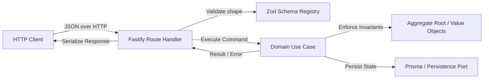

# Tutorial: Building a Contract-First REST API on Clean Architecture

This tutorial walks through building a production-grade, contract-first REST API surface on top of Clean Architecture and Domain-Driven Design (DDD), using Verixa's `apps/api` and core domain packages as the concrete implementation reference.

Every concept described here is backed by real code and automated tests in the repository:

- Contract definition and validation: [`apps/api/src/openapi/zod-registry.ts`](file:///C:/DripsWave/verixa/apps/api/src/openapi/zod-registry.ts)
- Standardized error contracts: [`apps/api/src/http/error-response.ts`](file:///C:/DripsWave/verixa/apps/api/src/http/error-response.ts)
- Composition Root: [`apps/api/src/composition-root.ts`](file:///C:/DripsWave/verixa/apps/api/src/composition-root.ts)
- HTTP route translation: [`apps/api/src/routes/auth.ts`](file:///C:/DripsWave/verixa/apps/api/src/routes/auth.ts)
- Domain aggregate root: [`packages/identity/domain/entities/user.ts`](file:///C:/DripsWave/verixa/packages/identity/domain/entities/user.ts)
- Use case orchestration: [`packages/credentials/application/use-cases/register-user-with-password.ts`](file:///C:/DripsWave/verixa/packages/credentials/application/use-cases/register-user-with-password.ts)
- OpenAPI contract testing: [`apps/api/tests/contract/openapi-contract.test.ts`](file:///C:/DripsWave/verixa/apps/api/tests/contract/openapi-contract.test.ts)

---

## 1. Architectural Philosophy: The Separation of HTTP and Domain

In a clean architecture codebase, the HTTP layer is an adapter at the outermost ring. It has three specific responsibilities:

1. **Deserialize and validate protocol wire format**: Parse JSON, inspect path/query variables, and enforce strict payload schemas.
2. **Translate to use-case invocation**: Extract validated arguments and invoke domain use cases through the application container.
3. **Serialize output or domain errors**: Map use-case results or failures back to consistent HTTP status codes and payloads.

HTTP route handlers contain **no business logic, no SQL queries, and no Prisma client calls**. Domain models know nothing about HTTP requests, replies, headers, or Fastify.



---

## 2. OpenAPI-First and the Zod-to-OpenAPI Bridge

A recurring failure mode in API development is documentation drift: documentation is written in OpenAPI YAML, route validation is written in Joi or AJV, and TypeScript types are written by hand. Within months, none of them match.

Verixa solves this by making Zod the single source of truth for TypeScript types, Fastify runtime validation, and OpenAPI documentation components using [`registerZodSchema`](file:///C:/DripsWave/verixa/apps/api/src/openapi/zod-registry.ts#L24-L47):

```typescript
// apps/api/src/routes/auth.ts
const registerBodyZodSchema = z
  .object({
    email: z.string(),
    displayName: z.string(),
    password: z.string(),
    givenName: z.string().optional(),
    familyName: z.string().optional(),
  })
  .strict();

type RegisterBody = z.infer<typeof registerBodyZodSchema>;
```

### The Rule of Structural vs. Semantic Validation

Notice what is absent in `registerBodyZodSchema`: there is no `minLength(12)` on the password, and no complex regex for email formatting.

This is a deliberate architectural decision:

- **Fastify schema validates shape**: Is `email` a string? Are unexpected properties present (`.strict()`)? If malformed, reject immediately with HTTP 400.
- **The domain enforces business rules**: Password strength, character entropy, and email normalization rules belong to `RawPassword` and `Email` value objects in the domain.

Duplicating domain rules in the HTTP schema creates two sources of truth that drift. When the business updates password policy from 12 to 14 characters, updating it in the domain must immediately apply everywhere without updating multiple HTTP schemas.

### Registering Components with Fastify and OpenAPI

When routes are initialized, schemas are registered with the Fastify instance:

```typescript
const registerBodySchema = registerZodSchema(app, "RegisterBody", registerBodyZodSchema);

app.post<{ Body: RegisterBody }>(
  "/register",
  { schema: { body: registerBodySchema } },
  async (request, reply) => { ... }
);
```

[`enforceRegisteredRouteSchemas`](file:///C:/DripsWave/verixa/apps/api/src/openapi/zod-registry.ts#L57-L79) hooks into Fastify's `onRoute` event to reject any route declaring inline, unregistered schemas. This guarantees every request body or query parameter structure is registered as an OpenAPI component.

---

## 3. The Standard Error Contract (RFC 7807)

Clients should never have to guess the shape of an error. If some endpoints return `{ error: "message" }`, others `{ message: "...", code: 400 }`, and validation failures return `{ errors: [] }`, clients are forced to write brittle parsing logic.

In Verixa, all API errors use a single unified structure defined in [`apps/api/src/http/error-response.ts`](file:///C:/DripsWave/verixa/apps/api/src/http/error-response.ts#L14-L24):

```json
{
  "error": {
    "code": "VALIDATION_ERROR",
    "message": "Invalid request payload.",
    "requestId": "req-9b1deb4d-3b7d-4bad-9bdd-2b0d7b3dcb6d",
    "details": {
      "fields": {
        "email": "must be provided"
      }
    }
  }
}
```

Key invariants:

- **Stable machine-readable code**: `code` is an enum member from `API_ERROR_CODES` (e.g. `AUTHENTICATION_FAILED`, `CONFLICT`, `NOT_FOUND`). Clients branch on `code`, never on `message`.
- **Human-readable message**: `message` can be reworded for clarity at any time without breaking API clients.
- **Correlation ID tracking**: `requestId` is always included, allowing client developers to reference server logs effortlessly.
- **Never leak stack traces**: Even under unexpected internal errors (500), technical stack traces and SQL queries are logged internally but stripped from the HTTP response.

---

## 4. End-to-End Walkthrough: User Registration

Let us trace a single HTTP request—user registration—from network ingress to persistence and back.

### Step 1: Inbound HTTP Ingress & Schema Validation

An external client sends:

```http
POST /register HTTP/1.1
Content-Type: application/json

{
  "email": "Jane.Doe@example.com",
  "displayName": "Jane Doe",
  "password": "CorrectHorseBatteryStaple123!"
}
```

Fastify intercepts the request. The correlation plugin (`apps/api/src/plugins/request-id.ts`) assigns an `x-request-id` header. The schema compiler checks the body against `RegisterBody`.

### Step 2: Route Handler Translation

In [`apps/api/src/routes/auth.ts`](file:///C:/DripsWave/verixa/apps/api/src/routes/auth.ts#L82-L127):

```typescript
app.post<{ Body: RegisterBody }>(
  "/register",
  { schema: { body: registerBodySchema } },
  async (request, reply) => {
    try {
      const result = await container.credentials.registerUserWithPassword.execute({
        email: request.body.email,
        displayName: request.body.displayName,
        password: request.body.password,
        ...(request.body.givenName === undefined ? {} : { givenName: request.body.givenName }),
        ...(request.body.familyName === undefined ? {} : { familyName: request.body.familyName }),
      });

      if (Result.isErr(result)) {
        sendDomainError(reply, result.error);
        return;
      }

      const { user } = result.value;

      // Audit trail recording
      await container.audit.recordEvent.execute({
        action: "user.registered",
        subjectId: user.id,
        metadata: { email: user.email.value },
      });

      await reply.status(201).send({
        id: user.id,
        email: user.email.value,
        displayName: user.displayName.value,
        status: user.status,
        createdAt: user.createdAt.toISOString(),
      });
    } catch (error) {
      sendError(reply, error);
    }
  },
);
```

### Step 3: Domain Use Case & Entity Invariants

The handler passes control to `registerUserWithPassword.execute(command)`:

1. `Email.create(command.email)` normalizes `"Jane.Doe@example.com"` to `"jane.doe@example.com"`.
2. `DisplayName.create(command.displayName)` trims and verifies display name bounds.
3. `RawPassword.create(command.password)` evaluates character length and entropy.
4. The user repository checks whether an account with that email already exists. If yes, it returns `Result.err(new ConflictError(...))`.
5. The password hasher generates an Argon2id hash with cryptographic salt.
6. The user aggregate `User.register(...)` constructs the aggregate root in the `PENDING` or `ACTIVE` state.
7. Both the user entity and credential record are persisted in a transaction.

### Step 4: Outbound Response Mapping

The route handler extracts safe user properties. Notice:

- The credential hash is never placed in the response payload.
- Domain objects (`Email`, `DisplayName`) are unwrapped via `.value`.
- Dates are converted to ISO 8601 strings (`createdAt.toISOString()`).
- The response returns HTTP `201 Created`.

---

## 5. Cursor-Based Pagination

For collections (`GET /admin/roles`, `GET /admin/users`), offset pagination (`LIMIT / OFFSET`) scales poorly on large tables ($O(N)$ row skips) and suffers from page-drift anomalies when rows are inserted or deleted between requests.

Verixa adopts cursor-based pagination:

- Request query: `?limit=50&cursor=eyJpZCI6InJvbGUtMTIzIn0=`
- The cursor is an opaque, base64url-encoded token containing the sorting key (e.g., `id` or `createdAt`) of the last seen item.
- Response payload:
  ```json
  {
    "items": [ ... ],
    "pageInfo": {
      "hasNextPage": true,
      "endCursor": "eyJpZCI6InJvbGUtNDU2In0="
    }
  }
  ```
- Fastify route schemas enforce maximum limit caps (`max: 100`) to prevent resource exhaustion attacks.

---

## 6. Authentication & API-Key Verification

The REST layer supports both session-based authentication and machine-to-machine API key authorization:

1. **Header Extraction**: Fastify `preHandler` hooks extract either `Authorization: Bearer <jwt>` or `x-api-key: <key>`.
2. **Constant-Time Validation**: For API keys, tokens are verified against stored hashes using `crypto.timingSafeEqual` to eliminate timing side-channels.
3. **Principal Resolution**: Once verified, a `Principal` context is attached to the request (`request.principal = { userId, organizationId, permissions }`).
4. **Route Guards**: Administrative endpoints invoke guards like `requirePermission(request, reply, "roles:read")` before executing handlers.

---

## 7. Versioning Strategy

Verixa uses URI path prefixing for major API versions:

- Current stable version: `/v1`
- Backward-compatible additions (new optional fields in requests, new fields in responses) are introduced within the current version.
- Breaking changes (field removals, semantic changes to status codes) trigger a new version prefix (`/v2`).

Route files are modularized under `src/routes/` and mounted cleanly onto the Fastify instance via [`apps/api/src/composition/register-routes.ts`](file:///C:/DripsWave/verixa/apps/api/src/composition/register-routes.ts).

---

## 8. Summary Checklist for New REST Endpoints

When contributing a new endpoint to Verixa:

1. **Define Schema**: Create Zod DTO schema with `.strict()` and register it via `registerZodSchema`.
2. **Keep Handler Thin**: Delegate directly to a use case from the composition container.
3. **Handle Result Types**: Check `Result.isErr(result)` and map errors with `sendDomainError`.
4. **Audit Critical Actions**: Call `container.audit.recordEvent` for state-changing operations.
5. **Contract Test**: Add response contract assertions in `apps/api/tests/contract/openapi-contract.test.ts`.
